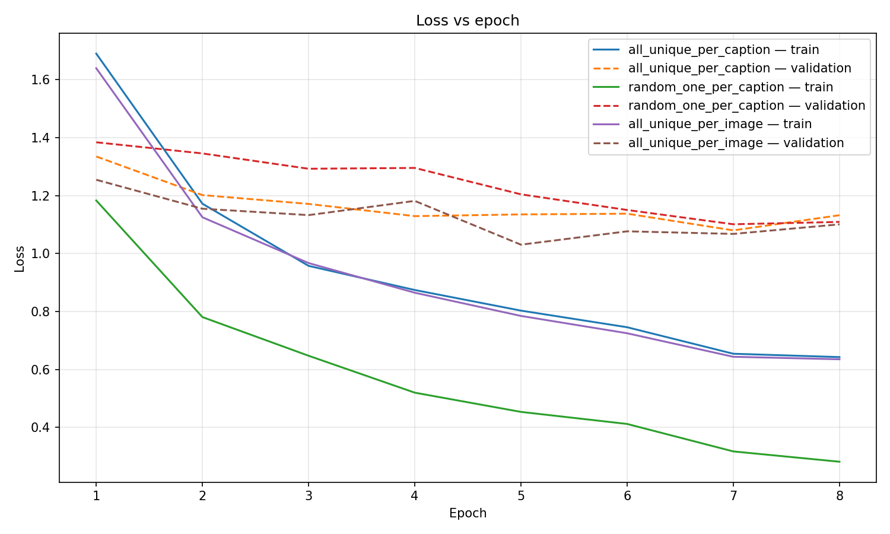
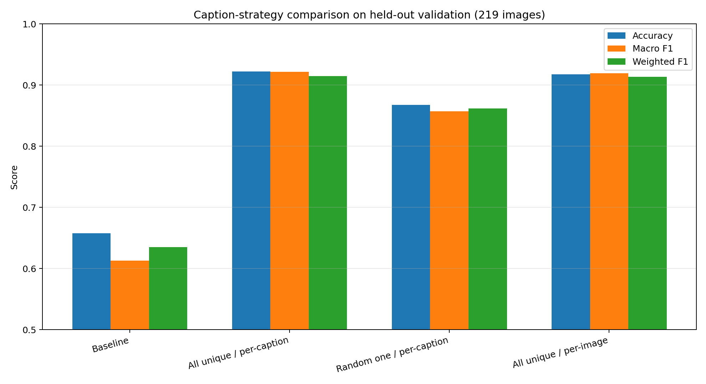
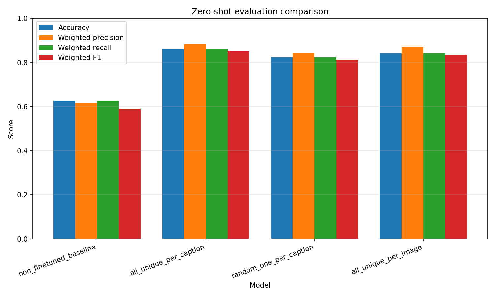

# Caption-strategy experiment

The experiment uses three full-run configurations that differ in caption selection and text-to-image weighting.

All three use the training recipe selected by the full matrix ablation. The winning ablation configuration was `bs16_adamw_lr_3e-5`.

The **all-unique/per-caption baseline** encodes every unique caption for an image and averages the text-to-image loss over captions. It exposes the model to all available descriptions, but images with more unique captions contribute more text-to-image terms. 

**Random-one/per-caption** instead uses one deterministic, seed-controlled caption sample per image per epoch. This keeps image exposure unchanged while reducing text-encoder work and giving every image one text-to-image term; the same caption may be sampled in consecutive epochs.

**All-unique/per-image** encodes the same captions as the baseline, but first averages caption losses within each image so every image has equal text-to-image weight. All three variants use the same all-unique/per-caption validation objective.

| Configuration | Training captions | Text-to-image weighting | Question tested |
| --- | --- | --- | --- |
| `finetune_full_config.yaml` | All unique captions | Per caption | Current multi-caption baseline |
| `finetune_full_random_one_config.yaml` | One seed-controlled sample per image per epoch | Per caption | Effect of using all captions; samples may repeat across epochs |
| `finetune_full_per_image_config.yaml` | All unique captions | Per image | Effect of caption-count weighting |

Run the three configurations from the repository root:

```bash
for config in open-clip/configs/experiment_caption_strategy/finetune_full*_config.yaml; do
  python open-clip/main_finetune.py --config "$config" --device cuda || break
done
```

They write to these separate directories:

```text
results/experiment_caption_strategy_2/open_clip_finetune_all_unique_per_caption
results/experiment_caption_strategy_2/open_clip_finetune_random_one_per_caption
results/experiment_caption_strategy_2/open_clip_finetune_all_unique_per_image
```

### Plotting training metrics

Plot all three training histories together with a separate labeled curve for
each model by running this command from the repository root:

```bash
python open-clip/plotting_utils.py \
  results/experiment_caption_strategy_2/open_clip_finetune_all_unique_per_caption \
  results/experiment_caption_strategy_2/open_clip_finetune_random_one_per_caption \
  results/experiment_caption_strategy_2/open_clip_finetune_all_unique_per_image \
  --label all_unique_per_caption \
  --label random_one_per_caption \
  --label all_unique_per_image \
  --output-dir results/experiment_caption_strategy_2/training_metric_plots
```

The command writes loss, positive text-to-image and image-to-text logits,
logit-scale, and learning-rate plots. Each plot compares all three models over
their training epochs.



### Validation-set model selection

Parameter selection uses the exact 219-image held-out partition derived from
the RSICD `val` split. Its ordered filename SHA-256 is
`85b4c45a9272534a53be5e4790500e07d046219dca7b5be58c5ae6da10ac6b26`.
The test split is not used in this step.

Run the subset-aware comparison from the repository root:

```bash
python open-clip/main_zeroshot_compare_config_subset.py \
  --models-config open-clip/configs/experiment_caption_strategy/zeroshot_compare_validation_config.yaml \
  --device cuda \
  --output-dir evaluations/open_clip_caption_strategy_heldout_validation
```

The validation results are:

| Strategy | Accuracy | Macro F1 | Weighted F1 |
| --- | ---: | ---: | ---: |
| Pretrained baseline | 65.75% | 61.28% | 63.50% |
| All unique / per-caption | **92.24%** | **92.14%** | **91.48%** |
| Random one / per-caption | 86.76% | 85.68% | 86.17% |
| All unique / per-image | 91.78% | 91.91% | 91.37% |

All unique captions with per-caption weighting is the validation-selected
strategy because it leads both accuracy and macro F1. Its margin over per-image
weighting is small: one correctly classified image and approximately 0.23
percentage points of macro F1.



### Test-set reporting

After the strategy has been frozen using validation, compare the checkpoints
with the original non-fine-tuned OpenCLIP model on the 1,093-image RSICD test
split. The model list and dataset paths are defined in
`zeroshot_compare_config.yaml`. These test results are reporting-only and must
not change the selected strategy.

Run the comparison from the repository root:

```bash
python open-clip/main_zeroshot_compare.py \
  --models-config open-clip/configs/experiment_caption_strategy/zeroshot_compare_config.yaml \
  --device cuda \
  --output-dir evaluations/open_clip_caption_strategy_comparison_2
```

The test results are:

| Strategy | Accuracy | Macro F1 | Weighted F1 |
| --- | ---: | ---: | ---: |
| Pretrained baseline | 62.67% | 58.20% | 59.09% |
| All unique / per-caption | **86.28%** | **86.51%** | **84.96%** |
| Random one / per-caption | 82.25% | 82.55% | 81.35% |
| All unique / per-image | 84.17% | 84.36% | 83.55% |

The test ordering agrees with the validation selection, but it is not selection
evidence. These test scores had already been inspected before the validation
protocol was formalized, so that history should be disclosed when reporting
the experiment.



The evaluation writes an aggregate `summary.json`, comparison plots, and
per-model metrics, predictions, and confusion matrices beneath
`evaluations/open_clip_caption_strategy_comparison_2/`. The
`non_finetuned_baseline` entry uses the original local OpenCLIP checkpoint;
the other entries use each training run's `ckp_best.pth`.

The fixed budget is equal image exposure rather than equal text-encoder compute.
All configurations use the same source and derived split, seed, image batch
size, eight epochs, `drop_last=False`, optimizer-step count, and shuffled image
order. The all-unique configurations encode more captions than `random_one`.
The per-image configuration isolates loss normalization; it is not a
compute-matched alternative.

For every epoch, compare these entries in each run's `metrics.json`:

- `train.image_order_sha256`, `train.images`, and `train.optimizer_steps` must
  match across runs.
- `train.captions` and `train.captions_per_image` show the text-compute
  difference.
- `train.text_to_image_loss`, `train.image_to_text_loss`, and
  `train.objective_loss` describe the configured training objective.
- `validation.selection_loss` is the common all-unique/per-caption metric used
  for checkpoint selection. It is intentionally not the random-one run's
  training objective.
