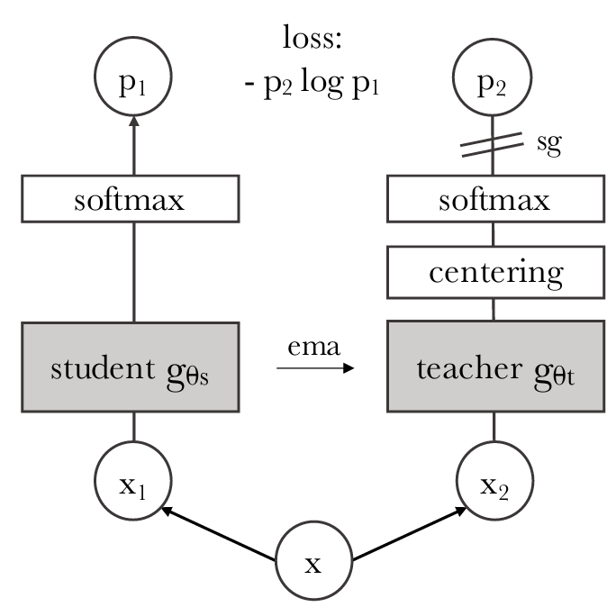
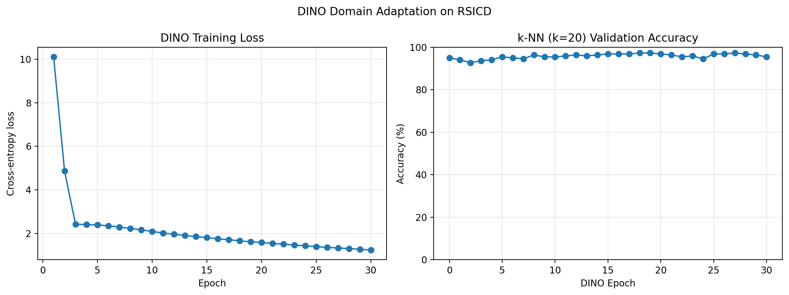

# DINO implementation
This project investigates self-supervised domain adaptation of a pretrained CLIP visual encoder to remote sensing imagery using DINO.

We initialize the student and teacher networks from the visual encoder of OpenCLIP ViT-B/32 and train them on unlabeled RSICD images using DINO's objective. After training, we discard the projection head and evaluate the frozen features with a weighted k-NN classifier, as in DINO (a linear probe is available as an alternative), across the 31 classes of the RSICD dataset.


## Background on DINO

DINO is an SSL method based on distillation between two networks: a **student** and a **teacher**. 

Both are initially identical. During training:
- The student learns by minimizing a cross-entropy loss between its predictions and the teacher's predictions.
- The teacher is updated based on the student parameters.
- No labels.

See a simplified sketch with only 2 views in the image below, from the [original DINO paper](https://arxiv.org/abs/2104.14294). [Official implementation](https://github.com/facebookresearch/dino).

<p align="center">
  
</p>


### Data
The input data consists of augmentations from the same input data x. 
- student: 2 global crops + 8 local crops
- teacher: 2 global crops

where the definition of _global_ and _local_ crops are:
- global crop: image area is 40-100% of the original image area
- local crop: image area is 5 to 40% of the original image area

**Implementation detail:** Original DINO resizes global crops to 224×224 pixels and local crops to 96×96 pixels. In our case, all crops as 224x244 to avoid interpolating positional embeddings.

### DINO loss

Let
- $P_t^{(i)}$ teacher's output distribution for global view $i$.
- $P_s^{(j)}$ student's output distribution for view $j$.
- $H(P_t,P_s)$ cross-entropy between the teacher and student distributions.

The cross-entropy is:

$$
H(P_t,P_s) = -\sum_{k=1}^{K}P_{t,k}\log P_{s,k},
$$

where $K$ is the dimensionality of the DINO output space.

Assuming there are 2 global crops and 8 local crops, there will be 18 cross-view loss terms:

$$
L = \frac{1}{18}*\sum_{i=1}^{2}\sum_{j=1,j\neq i}^{10} H(P_{t}^{(i)}, P_{s}^{(j)}).
$$

The student and teacher probability distributions are computed as:

$$
P_s = \text{softmax} \frac{z_s}{\tau_s}
$$

$$
P_t = \text{softmax} \frac{z_t - c}{\tau_t}
$$

where:
- $z_s$ and $z_t$ are the student and teacher projection-head logits.
- $\tau_s$ and $\tau_t$ are their respective temperature parameters.
- $c$ is the running center of the teacher logits.

### Training
The student is updated with back-propagation, while the teacher is a moving average of the student:

$$
\theta_t = m*\theta_t + (1-m)*\theta_s.
$$

### Centering
The center is updated with momentum as well, for every new batch:

$$
c = m*c + (1-m) \frac{1}{B}\sum_{i=1}^{B}g_{\theta_t}(x_i)
$$


## Our implementation

### Model architecture

We use the visual encoder from **OpenCLIP ViT-B/32**, initialized with pretrained CLIP weights.

The student and teacher each consists of:

1. A pretrained CLIP visual encoder.
2. A three-layer MLP projection head with GELU activations.

The teacher is initialized as a copy of the student. After domain adaptation, only the student visual encoder is used for downstream classification.

### Monitoring the representation during training (k-NN)
To measure whether domain adaptation improves the visual representations, we classify the held-out labeled images every 5 epochs with a weighted k-NN classifier, as in DINO's [`eval_knn.py`](https://github.com/facebookresearch/dino/blob/main/eval_knn.py). The features are the L2-normalized image embeddings of the student encoder. Each held-out image votes with its `k = 20` most similar labeled reference images, and a neighbor with cosine similarity `s` adds `exp(s / 0.07)` to the score of its class. No classifier is trained.

The labeled images are the RSICD `val` split, divided into the same 875 reference and 219 held-out images that the other experiments of this repository use (`eval_split: project`, seed 42). The checkpoint with the highest k-NN accuracy on the 219 held-out images is selected as the best adapted model.

The earlier supervised linear probe is still available with `eval_method: linear_probe` in the config. Together with `eval_split: stratified` it reproduces the original protocol (logistic regression on a class-stratified 80/20 split).

A finished run does not have to be retrained to switch to k-NN. `select_checkpoint.py` scores saved checkpoints (and the original CLIP encoder, shown as epoch 0) with the same k-NN monitor, using the labeled split only:

```bash
python open-clip/dino/select_checkpoint.py \
    --checkpoints results/dino/checkpoint_epoch_*.pth
```

It prints the held-out k-NN accuracy per checkpoint, marks the selected one and writes `results/dino/knn_selection.json`.

### Training configuration

We train the pretrained CLIP visual encoder using DINO for 30 epochs.

The implementation uses hyperparameters inspired by the original DINO method, with modifications for domain adaptation. See [config file here](configs/dino_config.yaml).

| Hyperparameter | Configuration |
|----------------|---------------|
| Backbone | OpenCLIP ViT-B/32 |
| Training epochs | 30 |
| Global crops | 2 |
| Local crops | 8 |
| Crop input resolution | 224×224 |
| Local crop scale | 0.2–0.4 |
| Student temperature | 0.1 |
| Teacher temperature | 0.04 |
| Center momentum | 0.9 |
| Teacher EMA momentum | 0.996 (fixed) |
| DINO output dimension | 65,536 |
| MLP hidden dimension | 2,048 |
| MLP bottleneck dimension | 256 |

We also use separate learning rates for the pretrained visual encoder and the newly initialized projection head, not specified in DINO (afaik).


## Run training yourself
`python open-clip/dino/main_dino.py`

The monitored accuracies are written to `results/dino/history.json` (key `knn`, or `linear_probe` for the earlier protocol).

## Results
The numbers in this section and in the test evaluation below were obtained with the earlier linear-probe protocol. They have not been recomputed with k-NN yet.

Training loss, and linear probe evaluated on validation set:

.

| Metric | Original CLIP | DINO (Epoch 15) |
|---|---:|---:|
| Correct predictions | 207 / 219 | **215 / 219** |
| Accuracy | 94.52% | **98.17%** |


## Final Test Set Evaluation

After selecting the best DINO checkpoint (epoch 15), we evaluate the adapted visual encoder on the held-out RSICD test set.

1. Freeze the visual encoder and extract 512-dimensional image embeddings.
2. Train a logistic regression classifier on all 1,094 labeled validation images.
3. Evaluate classification performance on the 1,093 held-out test images.

### Results

| Metric | Original CLIP | DINO-adapted CLIP (Epoch 15) |
|---|---:|---:|
| Correct predictions | 1014 / 1093 | **1023 / 1093** |
| Accuracy | 92.77% | **93.60%** |
| Macro-F1 | 0.9209 | **0.9380** |

### Discussion

DINO domain adaptation improves test accuracy from **92.77% to 93.60%**. Macro-F1 also improves from **0.9209 to 0.9380**, suggesting improvements in classification performance across the different remote sensing classes.

The improvement on the held-out test set (+0.82 percentage points) is smaller than the improvement observed during validation (+3.65 percentage points).

#### Reproducing the Evaluation

From the repository root, the linear-probe numbers above:

```bash
python open-clip/dino/evaluate_test.py \
    --device cuda \
    --checkpoint results/dino/best_model.pth \
    --method linear
```

### k-NN evaluation on the test set

Without `--method`, `evaluate_test.py` uses the weighted k-NN classifier (`k = 20`, temperature 0.07):

1. Freeze the visual encoder and extract 512-dimensional image embeddings.
2. Use all 1,094 labeled validation images as the reference set. No classifier is trained.
3. Classify the 1,093 held-out test images once.

```bash
python open-clip/dino/evaluate_test.py \
    --device cuda \
    --checkpoint results/dino/best_model.pth
```

The script also reports the k-NN accuracy on the 219 held-out labeled images for `k` in {1, 5, 10, 20} (reference set: the 875 other labeled images), so `k` can be checked without the test split. It prints an exact McNemar test between the original and the adapted encoder and writes `metrics.json` and the per-image test predictions to `evaluations/dino_knn/`. `--method both` runs k-NN and the linear probe in one go.

Both the k-NN classifier and the linear probe use the scene labels of the labeled split, so they are supervised evaluations of the frozen features and complement the zero-shot evaluation of the other models.
