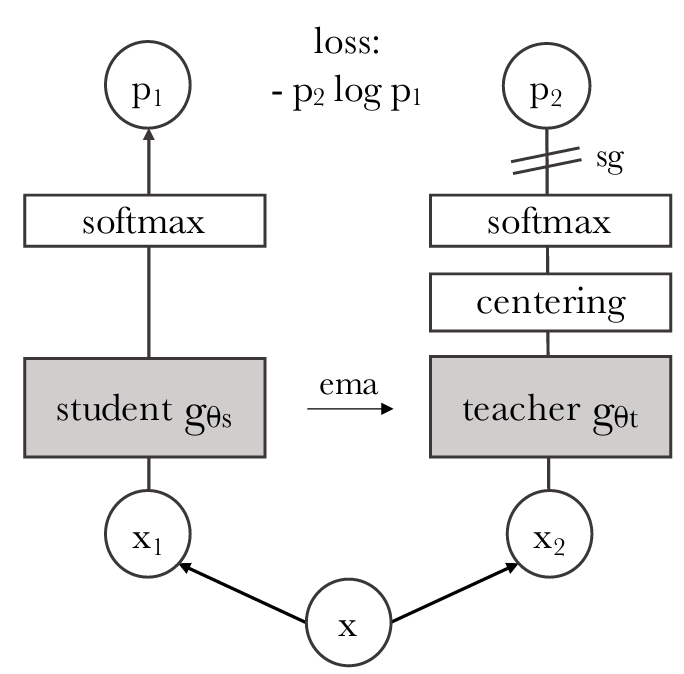
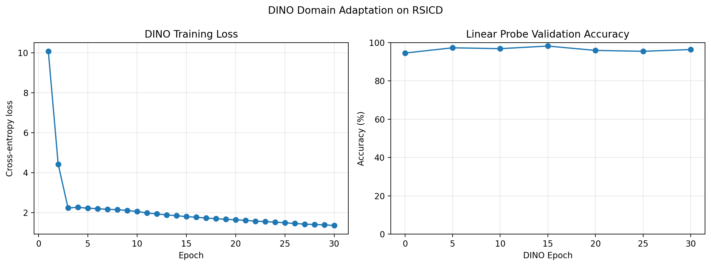

# DINO implementation
This project investigates self-supervised domain adaptation of a pretrained CLIP visual encoder to remote sensing imagery using DINO (Self-Distillation with No Labels).

We initialize the student and teacher networks from the visual encoder of OpenCLIP ViT-B/32 and train them on unlabeled RSICD images using DINO's self-distillation objective. After training, we discard the projection head and evaluate the adapted visual representations using linear-probe classification across the 31 of the RSICD dataset.


## Background on DINO

### Intro
DINO is a self-supervised learning method on data _without labels_ based on knowledge distillation between two networks: a **student** and a **teacher**. 

Both networks share the same architecture and are initially identical. During training:
- The student learns by minimizing a cross-entropy loss between its predictions and the teacher's predictions.
- The teacher is updated based on the student parameters.
- No class labels are required.

See a simplified sketch with only 2 views in the .

For further details, see the [original DINO paper](https://arxiv.org/abs/2104.14294) and the [official implementation](https://github.com/facebookresearch/dino).


### Data
The input data consists of augmentations from the same input data x. 
- student: 2 global crops + 8 local crops
- teacher: 2 global crops

where the definition of _global_ and _local_ crops are:
- global crop: image area is 40-100% of the original image
- local crop: image area is 5 to 40% of the original image

**Implementation detail:** Original DINO resizes global crops to 224×224 pixels and local crops to 96×96 pixels. In our OpenCLIP ViT-B/32 implementation, both global and local crops are resized to **224×224 pixels**, avoiding the need to interpolate the pretrained positional embeddings.

### DINO loss

Let
- $P_t^{(i)}$ denote the teacher's output distribution for global view $i$.
- $P_s^{(j)}$ denote the student's output distribution for view $j$.
- $H(P_t,P_s)$ denote cross-entropy between the teacher and student distributions.

The cross-entropy is:

$$
H(P_t,P_s) = -\sum_{k=1}^{K}P_{t,k}\log P_{s,k},
$$

where $K$ is the dimensionality of the DINO output space.


Assuming there are 2 global crops and 8 local crops, the loss is defined as:

$$
L = \frac{1}{18}*\sum_{i=1}^{2}\sum_{j=1,j\neqi}^{10} H(P_{t}^{(i)}, P_{s}^{(j)}).
$$

The same-view comparisons between the teacher and student are excluded. This leaves 18 cross-view loss terms.

The student and teacher probability distributions are computed as:

$$
P_s = \text{softmax} \frac{z_s}{\tau_s}
$$

$$
P_t = \text{softmax} \frac{z_t - c}{\tau_t}
$$

where:
- $z_s$ and $z_t$ are the student and teacher projection-head logits.
- $\tau_s$ and $\tau_t$ are their respective temperature parameters.
- $c$ is the running center of the teacher logits.

### Training
The student is updated with back-propagation, while the teacher is a moving average of the student:

$$
\theta_t = m*\theta_t + (1-m)*\theta_s.
$$

In the original DINO implementation, the teacher momentum follows a cosine schedule, increasing toward 1 throughout training. Here, we leave it fixed to 0.996 for simplicity.

### Centering
The center is updated with momentum as well, for every new batch:

$$
c = m*c + (1-m) \frac{1}{B}\sum_{i=1}^{B}g_{\theta_t}(x_i)
$$


## Our implementation

### Model architecture

We use the visual encoder from **OpenCLIP ViT-B/32**, initialized with pretrained CLIP weights.

The student and teacher each consists of:

1. A pretrained CLIP visual encoder.
2. A three-layer MLP projection head with GELU activations.
3. L2 normalization of the bottleneck representation.
4. A final weight-normalized linear layer producing the DINO logits.

The teacher is initialized as a copy of the student.

After domain adaptation, the projection heads are discarded. The adapted **student visual encoder** is retained for downstream classification.

### Linear probe evaluation
To measure whether domain adaptation improves the visual representations, we perform linear-probe classification.

At regular intervals (every 5 epochs):

1. Freeze the student visual encoder.
2. Extract image embeddings from labeled validation data.
3. Train a linear classifier on a designated labeled subset.
4. Evaluate classification accuracy on a separate held-out labeled subset.

The checkpoint with the highest measured linear-probe validation accuracy is selected as the best adapted model.

### Training configuration

We train the pretrained CLIP visual encoder using DINO for 30 epochs.

The implementation uses hyperparameters inspired by the original DINO method, with modifications for domain adaptation.

| Hyperparameter | Configuration |
|----------------|---------------|
| Backbone | OpenCLIP ViT-B/32 |
| Training epochs | 30 |
| Global crops | 2 |
| Local crops | 8 |
| Crop input resolution | 224×224 |
| Local crop scale | 0.2–0.4 |
| Student temperature | 0.1 |
| Teacher temperature | 0.04 |
| Center momentum | 0.9 |
| Teacher EMA momentum | 0.996 (fixed) |
| DINO output dimension | 65,536 |
| MLP hidden dimension | 2,048 |
| MLP bottleneck dimension | 256 |

The global crop range, learning rates, batch size, and other settings are specified in `configs/dino_config.yaml`.

The original DINO implementation uses cosine schedules for several training hyperparameters, including teacher momentum and weight decay. Our current implementation uses fixed values for these parameters. 

We also use separate learning rates for the pretrained visual encoder and the newly initialized projection head.


## Run training yourself
`python open_clip/dino/main_dino.py`

## Results
Training loss, and linear probe evaluated on validation set:

.

| Metric | Original CLIP | DINO (Epoch 15) |
|---|---:|---:|
| Correct predictions | 207 / 219 | **215 / 219** |
| Accuracy | 94.52% | **98.17%** |


## Final Test Set Evaluation

After selecting the best DINO checkpoint (epoch 15) based on linear-probe validation accuracy, we evaluate the adapted visual encoder on the held-out RSICD test set.

For both the original CLIP encoder and the DINO-adapted encoder:

1. Freeze the visual encoder and extract 512-dimensional image embeddings.
2. Train a logistic regression classifier on all 1,094 labeled validation images.
3. Evaluate classification performance on the 1,093 held-out test images.

Both models use the same training and test images, preprocessing, and linear-probe configuration.

### Results

| Metric | Original CLIP | DINO-adapted CLIP (Epoch 15) |
|---|---:|---:|
| Correct predictions | 1014 / 1093 | **1023 / 1093** |
| Accuracy | 92.77% | **93.60%** |
| Macro-F1 | 0.9209 | **0.9380** |

### Discussion

DINO domain adaptation improves test accuracy from **92.77% to 93.60%**, corresponding to nine additional correctly classified images out of 1,093 test samples.

Macro-F1 also improves from **0.9209 to 0.9380**, suggesting improvements in classification performance across the different remote sensing classes.

The improvement on the held-out test set (+0.82 percentage points) is smaller than the improvement observed during validation (+3.65 percentage points).

This highlights the importance of evaluating domain-adapted representations on unseen data, rather than relying exclusively on validation accuracy.


#### Reproducing the Evaluation

From the repository root:

```bash
python open-clip/dino/evaluate_test.py \
    --device cuda \
    --checkpoint results/dino/best_model.pth
```


