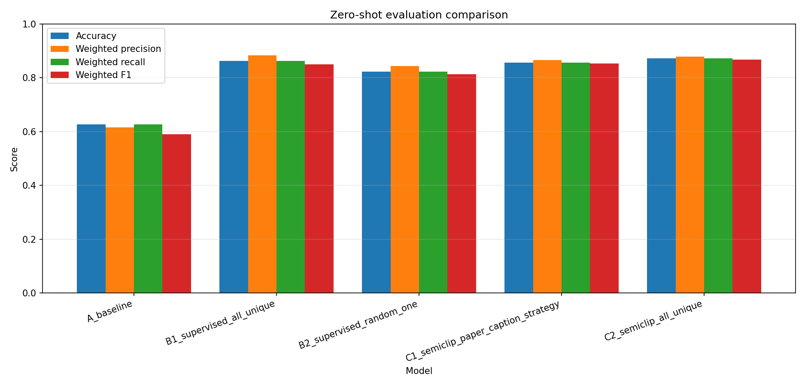

# Report Results

This file aims to gather and summarize all models that has been trained and evaluated, that should be included in the final report.

## Evaluated Models

Evaluated models with descriptions.

Unfortunatley it's not suitable to add the checkpoints to the git repo due to file-size limitations. Ask Caroline if you need any of the artifacts, or re-produce the results by training the model yourself by following the instructions in the respective readme. None of the models are trained for particularly long time, so it should be rather fast. 

If you want to add another model to the comaprison, you can also instead make use of the stored evaluation metrics for each model to re-generate an updated figure/table.

| Model ID | Model / Checkpoint | Description |
| --- | --- | --- |
| A | `ViT-B-32-laion2b_s34b_b79k.bin` | Baseline clip model, no fine-tuning |
| B1 | `open_clip_finetune_all_unique_per_caption/open_clip_finetune_all_unique_per_caption_ckp_best.pth` | Supervised fine-tuning (all unique captions) |
| B2 | `open_clip_finetune_random_one_per_caption_ckp_best.pth` | Supervised fine-tuning (random one caption) |
| C1 | `semiclip_paper_1gpu_seed42_stage2_final.pt` | Semi-clip fine-tuning (paper caption strategy) |
| C2 | `semiclip_paper_1gpu_all_unique_seed42_stage2_final.pt` | Semi-clip fine-tuning (all unique captions) |

All models are evaluated using the eval config file under the `report-results´ folder (same file can be used for both zero-shot and retreival evals). If you want to add a model variant to the eval suite, add it to the config file.

## Metrics and Results on *Test*

Commands for running evaluation comparisons:

```bash
python open-clip/main_retrieval_compare.py --device cuda --output-dir report-results/metrics/retreival --models-config report-results/compare_config.yaml
```

```bash
python open-clip/main_zeroshot_compare.py --device cuda --output-dir report-results/metrics/zeroshot --models-config report-results/compare_config.yaml
```

### Zero-Shot



### Retreival

Image-to-text retrieval accuracy on the 1,093-image RSICD test split:

| Model ID | Model | Accuracy@1 (%) | Accuracy@3 (%) | Accuracy@5 (%) | Accuracy@10 (%) |
| --- | --- | ---: | ---: | ---: | ---: |
| A | Baseline | 6.31 | 15.83 | 22.60 | 35.41 |
| B1 | Supervised, all unique captions | 12.72 | 27.08 | 35.59 | 52.42 |
| B2 | Supervised, random-one caption | 9.97 | 20.95 | 29.83 | 45.38 |
| C1 | SemiCLIP, paper caption strategy | 10.16 | 24.98 | 35.86 | 50.87 |
| C2 | SemiCLIP, all unique captions | 11.80 | 28.18 | 37.51 | 53.16 |

## Model Training Details

This section provideds details about how each of the evaluated models was trained, including any ablation studies performed to select hyper-params.

### A: Baseline
Downloaded from open-clip with `curl -L https://huggingface.co/laion/CLIP-ViT-B-32-laion2B-s34B-b79K/resolve/main/open_clip_pytorch_model.bin -o weights/open_clip/ViT-B-32-laion2b_s34b_b79k.bin`

### B1,B2: Supervised Fine-Tuning

The ablation study for finding training parameters is described in separate [readme file](../open-clip/configs/ablation_matrix_search/README.md). Results are reported [here](results/finetune_ablation_matrix_search/comparison_report/report.md).

B1 and B2 models was trained as described [here](open-clip/configs/experiment_caption_strategy/README.md), using the training parameter from the ablation study.

### C1,C2: Semi-clip

Models are trained using the training parameters given by the paper, for detail see the separate [readme](../open-clip/semiclip/semiclip-random-caption-test-set-eval.md) for the model using the papers original caption strategy, and this [readme](../open-clip/semiclip/semiclip-all-unique-caption-test-set-eval.md) for the model with our all unique captions variant.